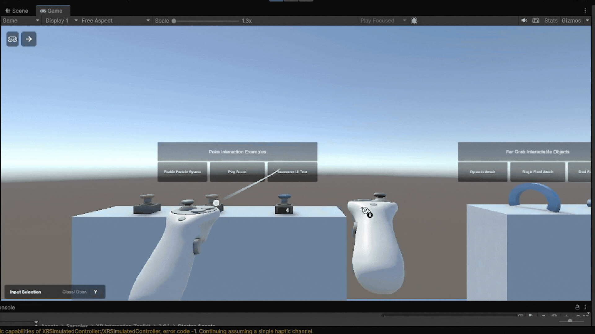
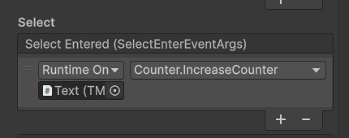
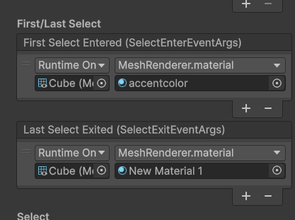
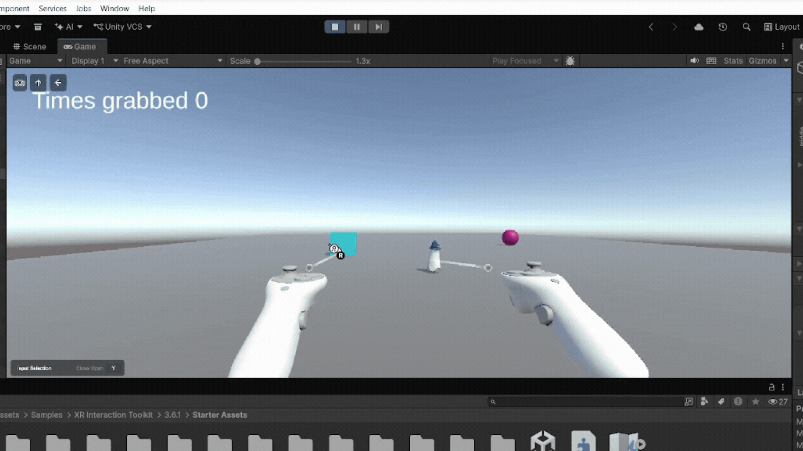

# Practica6

Práctica 6 de Interfaces Inteligentes

* **Autor:** Sonia Frías Jiménez 
* **ALU** alu0101492513@ull.edu.es
* **Versión de Unity:** 6.6

Para la realización de la práctica primero se ha configurado XR Interaction Toolkit. Tras varios intentos tratando de utilizar el simulador de Meta, sin exito, se ha pasado a utilizar el simulador genérico del XR Interaction Toolkit.

# Ejercicio
Agrega en la escena un cubo, una esfera y un objeto de la asset store que elijas sobre un plano, cada uno de ellos a diferentes distancias. El cubo y esfera serán Ray Interactor que cambian de color al seleccionarlo. El objeto de la asset store será un Direct Interactor que actualiza la UI al agarrarlo.

---

Se ha creado una nueva escena y como indica el enunciado se han añadido un cubo, una esfera y un [asset](https://assetstore.unity.com/packages/3d/characters/little-ghost-lowpoly-free-271926) colocados a distintas distancias. Luego se ha borrado la `Main camera` y se ha añadido `XR Origin (XR Rig)` directamente desde los started assets, lo que permite crear el jugador y como interacciona con el entorno fácilmente.

A continuación, a la esfera y el cubo se les ha añadido un componente `XR Simple Interaction` y directamente desde el inspector en "XR Simple Interaction > Interactable Events > Select Entered" se ha añadido la funcionalidad para el cambio de color. Además, se ha añadido la funcionalidad para que al dejar de seleccionar el objeto vuelva a su color inicial.

No ha sido necesario crear un script para ello ya que es una funcionalidad ya integrada.

Para el objeto de la asset store se le añade el componente `XR Grab Interaction` lo que permite interactuar con el agarrandolo, cosa que el `XR Simple Interaction` no permite. Dado que la funcionalidad a implementar es modificar la UI se ha creado un Canvas con un texto en la escena y se ha creado el [script](scripts/Counter.cs) que gestiona los cambios en el mismo. Por último, se le añade al inspector la funcionalidad de la misma manera que en el caso anterior.

### Prueba

